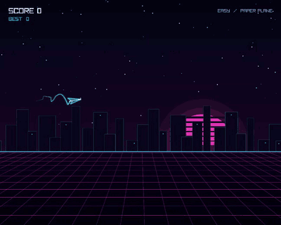
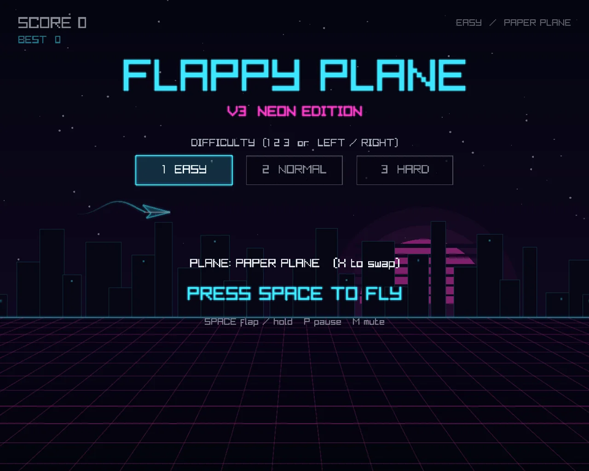
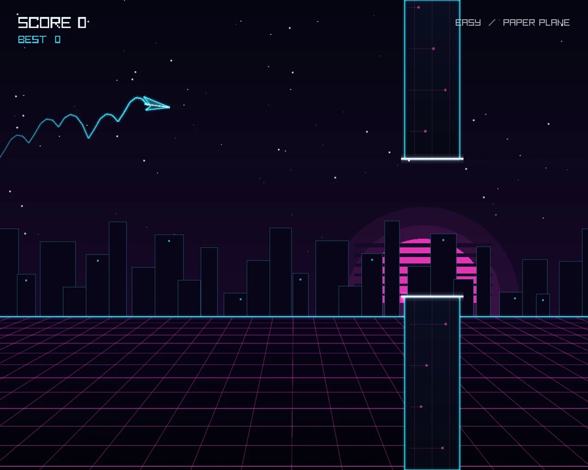
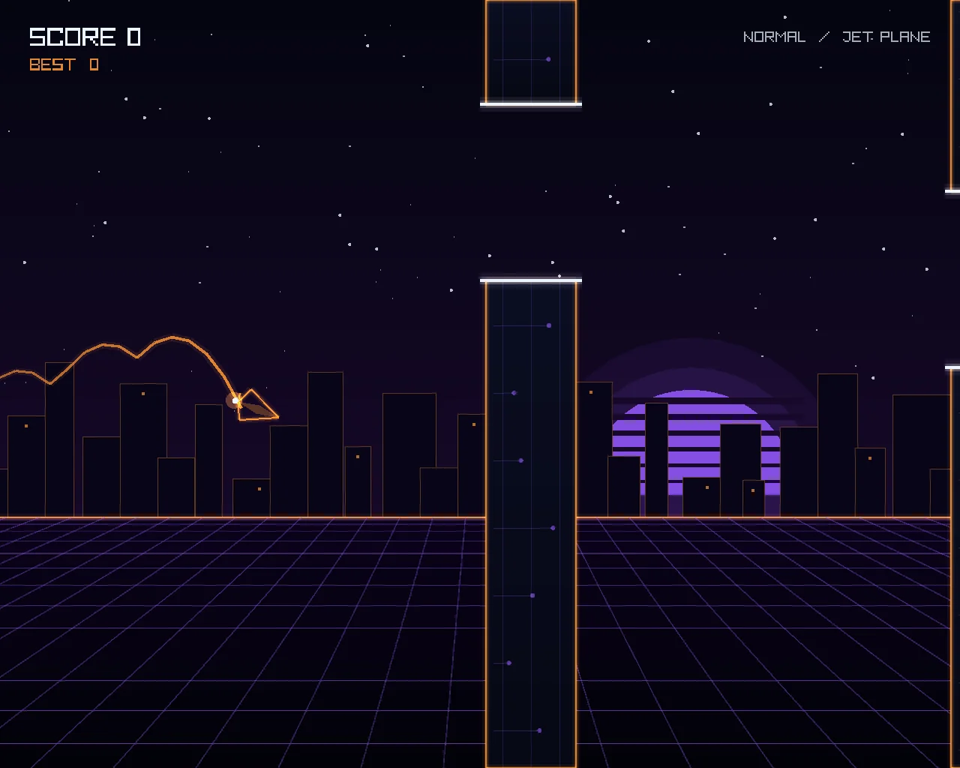
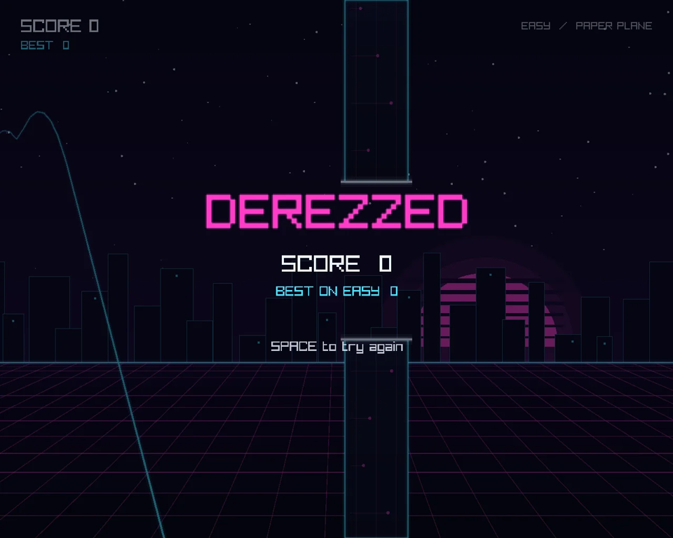

# Flappy Plane



A Flappy Bird style game in C++ and raylib. It started as a Programming 1 group compulsory at INN in 2025 (I wrote most of the code) and I kept poking at it after. This repo holds all three versions, one per branch.

**Play it in the browser:** [sundorigin.org/play.html](https://sundorigin.org/play.html) or on [itch.io](https://rillianz.itch.io)

| Branch | Version | What it looks like |
| --- | --- | --- |
| [`main`](https://github.com/RillianZ/flappy-plane/tree/main) | **v3 Neon edition** (2026) | Synthwave grid, everything drawn in code, difficulty select |
| [`2025-pixel-clouds`](https://github.com/RillianZ/flappy-plane/tree/2025-pixel-clouds) | **The one I handed in** (2025) | Pixel art city, brick towers and those big cloud ghosts that sit right in your way |
| [`2025-skyscrapers`](https://github.com/RillianZ/flappy-plane/tree/2025-skyscrapers) | **Before the pixel art** (2025) | Photo skyscrapers as obstacles and a real skyline in the back |

They all build off the same code. Same game states, same flight physics, same controls.

## v3 Neon edition (this branch)

| | |
| --- | --- |
|  |  |
|  |  |

What's new compared with the 2025 version:

- Neon grid look, all drawn in code. No image files at all.
- Light trail behind the plane, derez particles when you crash, +1 popups
- Synth sound effects and two synthwave loops (one per plane), generated by a Python script
- Easy / Normal / Hard. Changes the gap, the space between towers and the speed.
- The gap can't jump further than the plane can actually climb. No more impossible towers. You're welcome.
- Time based movement, so it plays the same at 60, 120 or 144 FPS (the original moved a fixed amount per frame, oops)
- Separate high score per difficulty
- Mute button

## Controls

| Key | What it does |
| --- | --- |
| Space | Flap (hold to climb harder) |
| X | Swap between paper plane and jet |
| 1 2 3 or Left / Right | Pick difficulty |
| P | Pause |
| M | Mute |

## Build it

**Windows, Visual Studio:** open `RayLibStarterTemplateEmpty.sln` and press F5. raylib is already in `lib/`. The game loads sounds from `resources/`, so run it from the project folder (that's the default in Visual Studio) or put `resources/` next to the exe when you share it. Needs raylib 5.0 or newer.

**Web (Emscripten + raylib built with `PLATFORM=PLATFORM_WEB`):**

```
em++ src/main.cpp -o flappy-plane-v3.js -O2 -std=c++17 -I<raylib>/src <raylib>/src/libraylib.a \
  -DPLATFORM_WEB -sUSE_GLFW=3 -sASYNCIFY -sALLOW_MEMORY_GROWTH=1 -sINITIAL_MEMORY=67108864 \
  -sEXIT_RUNTIME=0 --preload-file resources@resources
```

**New sounds:** `python tools/make_audio.py` rebuilds every sound in `resources/` from code (needs numpy, and ffmpeg for the .ogg files).

## Files

```
src/main.cpp           the whole game
resources/             sound effects and music
tools/make_audio.py    makes all the sounds
docs/                  screenshots and the gif for this readme
lib/                   raylib for Visual Studio
```

## Credits

Made by Noah Sund ([Sund Origin Studio](https://sundorigin.org)). The 2025 versions were made in Group 3 at INN, and the full commit history from the group repo is kept here so everyone's commits are still credited. v3 was made with help from Claude.
