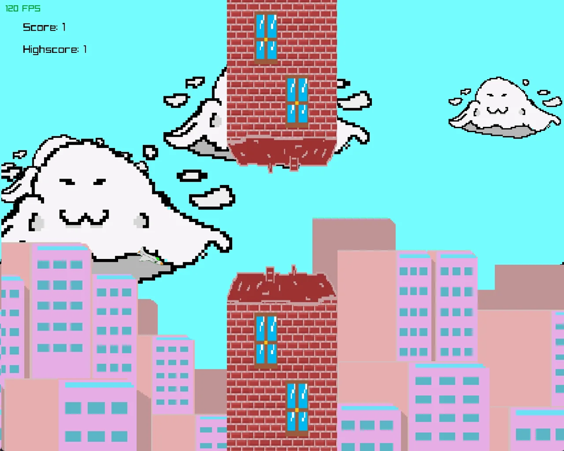
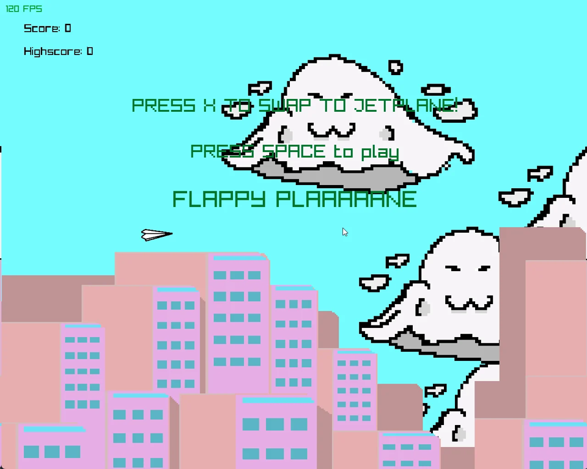
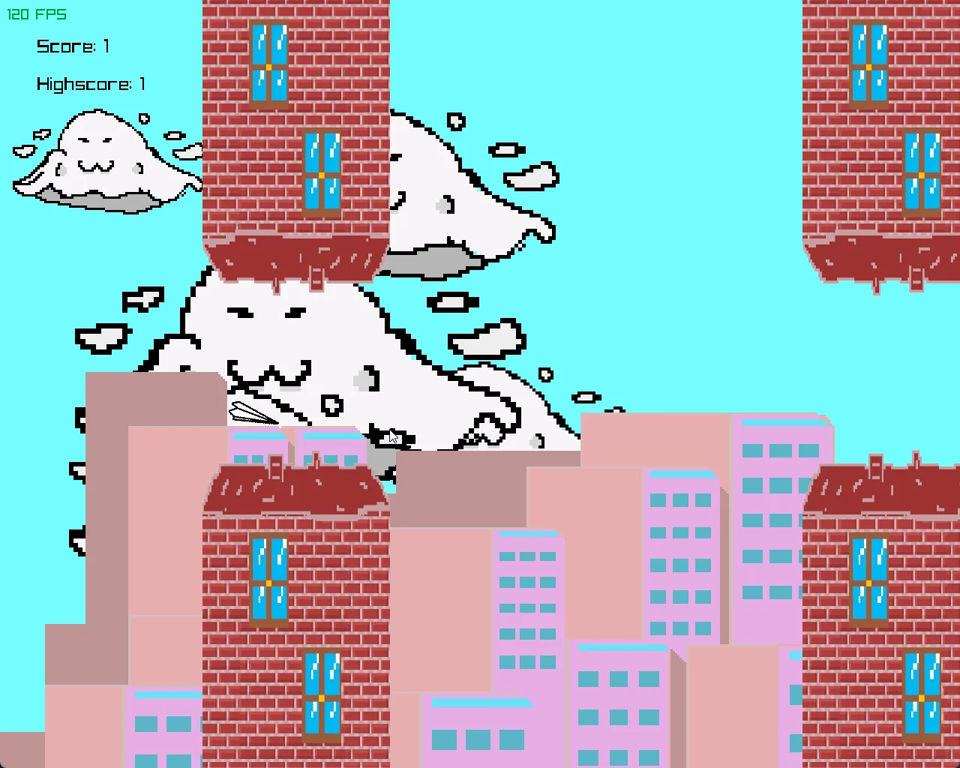

# Flappy Plane (2025, the one I handed in)

My Programming 1 compulsory at INN, autumn 2025. C++ and raylib, one `main.cpp`. This is the final version we handed in: pixel art city in the back, brick towers as obstacles, and big cloud ghosts floating around that get right in your face. Very annoying. On purpose? Let's say yes :)

**Play it in the browser:** [sundorigin.org/play.html?v=2025](https://sundorigin.org/play.html?v=2025)

| | |
| --- | --- |
|  |  |

## What's in it

- Score and high score
- Two planes, paper plane and jet, each with its own music and flap sound
- Hold Space for a little extra lift
- Pause
- Logo screen, title screen, game over screen

## Controls

| Key | What it does |
| --- | --- |
| Space | Start, flap (hold to climb a bit harder) |
| X | Swap between paper plane and jet plane (the music changes too) |
| P | Pause |

## Build it

Windows and Visual Studio: open `RayLibStarterTemplateEmpty.sln` and press F5. raylib is in `lib/`. The textures and sounds load from `src/Resources/`, so run it from the project folder (the default in Visual Studio).

## The other versions

This repo has all three versions of Flappy Plane, one per branch:

- [`main`](https://github.com/RillianZ/flappy-plane/tree/main): v3 Neon edition (2026), the remaster. Also [playable in the browser](https://sundorigin.org/play.html).
- [`2025-pixel-clouds`](https://github.com/RillianZ/flappy-plane/tree/2025-pixel-clouds): the version I handed in
- [`2025-skyscrapers`](https://github.com/RillianZ/flappy-plane/tree/2025-skyscrapers): the version before the pixel art

## Credits

Programming 1 group compulsory at INN, Group 3, autumn 2025. I wrote most of the code. The pixel art textures came from a teammate. The full commit history from the group repo is kept on this branch, so everyone's commits are still here. Made by Noah Sund, [Sund Origin Studio](https://sundorigin.org).
